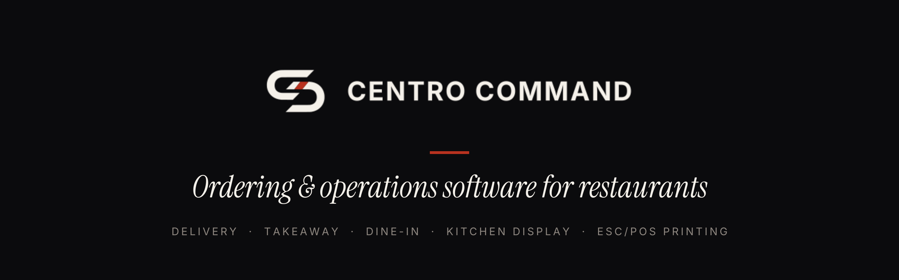

  

**Centro Command** is a restaurant ordering and operations platform for delivery, takeaway and dine-in, designed by a restaurant operator with 15 years in food service.

**What it does**

- Customer web ordering: complex menus (variants, modifiers, combos, half-and-half), allergen gate, live order status
- Staff command centre and kitchen display with stations, courses and expo
- ESC/POS network printing with audited reprints and recovery after printer failure
- Stripe payments, GDPR retention and erasure, plugin lifecycle for integrations
- Dine-in module in final integration: table plans, QR ordering at the table, split bills, reservations

**Engineering** · Next.js · React · TypeScript · Supabase / PostgreSQL with row-level security · automated CI on every change · data room with architecture, install and restore guides

**Status** · The source code is private and available for exclusive acquisition, domain included.

**[Live demo](https://demo.centrocommand.com)** · **[Founder on LinkedIn](https://www.linkedin.com/in/himusheikh)** · **founder@centrocommand.com**
